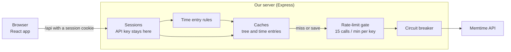

# Memtime

A web app for browsing clients, projects and tasks and for logging time entries against the Memtime API.

## Start here

1. [Assumptions](docs/ASSUMPTIONS.md): what I assumed and why the solution looks the way it does.
2. [Decisions](docs/adr/README.md): one short record per design decision.
3. [Improvements](docs/IMPROVEMENTS.md): what I would do next.

## Architecture



The browser never sees the API key. The server checks entries against the rules, answers from its caches when it can, and calls Memtime only within the rate limit.

## Getting started

Requires Node 22+ and pnpm 10 (`corepack enable` will give you the pinned version).

```bash
pnpm install
cp server/.env.example server/.env       # optional; every variable has a default
cp frontend/.env.example frontend/.env   # optional; the proxy defaults to :3000
pnpm dev                                 # server on :3000, frontend on :5173
```

Open http://localhost:5173 and sign in with your Memtime API key.
